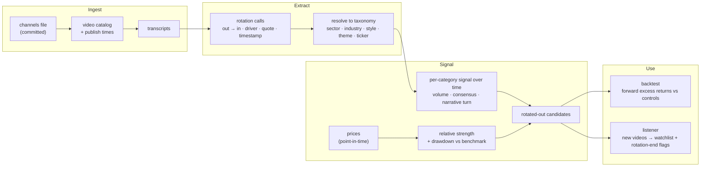

# rotation-tracker

Read what market commentators on YouTube say about money moving between sectors,
turn it into dated, structured rotation calls, and test whether the stocks and
sectors that get sold *because of a rotation* bounce back when the rotation ends.

> **Status: M1, data pipeline.** The source is FX Evolution's weekly market wrap
> (YouTube `@fxevolutionvideo`) from 2023 onwards, one video per week, stored in the
> shared Postgres and cut at its chapters so macro and flows commentary can be read
> on its own. Plan of record: [`ai_specs/s00_data_pipeline.md`](ai_specs/s00_data_pipeline.md).
>
> Research code, not investment advice. Nothing here places orders.

## The idea

A **rotation** is capital leaving one part of the market for another: megacap
tech into small caps, growth into value, cyclicals into defensives, semis into
software. A stock caught on the wrong side can fall hard with nothing wrong in
its own business. The selling is about flows, not fundamentals, and when the
rotation runs out or reverses, the money can come back.

Market commentators describe these flows as they happen, and they publish on a
date. That gives a dated record of *which* categories were said to be rotating,
*in which direction*, and *why*. This repo turns that record into:

1. **Rotation calls**: a structured, quote-grounded extraction from each
   transcript. What is rotating out, what is rotating in, the stated driver, and
   the tickers or categories named.
2. **A rotation signal**: those calls rolled up over time per category. How
   many sources say it, whether they agree, and when the narrative turns.
3. **A backtest** of the bounce: after a category or stock is named as rotated
   out *and* has fallen meaningfully, what does it return next, and does it beat
   the same drawdown with no rotation story attached?
4. **A listener**: the same pipeline run forward on new videos, producing a
   watchlist of rotated-out names and flagging when a rotation looks to be ending.

### The question the backtest has to answer

Losers bouncing is not new. Short-term reversal says recent losers tend to
recover whatever the reason, and industry momentum says sectors that have been
falling for months tend to keep falling. The question here is narrower:

> **Does knowing a drawdown was rotation-driven predict the rebound better than
> knowing the drawdown happened?**

So every result is reported against controls: the benchmark, a matched set of
names with the same drawdown and no rotation narrative, plain short-term
reversal, and industry momentum. "No edge over the control" is a valid finding
and gets reported like any other.

## How it works



**Point in time throughout.** A rotation call is dated to the video's publish
time (T0). Prices, constituents and every other input are read *as of* T0, and a
video published after the close becomes tradable at the next open.

## Roadmap

| Milestone | Builds | Done when |
|---|---|---|
| **M0** | README, `AGENTS.md`, public repo | this commit |
| **M1 corpus** | FX Evolution catalog with exact publish times, one wrap per week from 2023, transcripts cut at chapters and topic-tagged | every week since Jan 2023 has a transcript in `rt.transcripts`, with a cache so nothing is paid for twice |
| **M2 extraction** | rotation-call schema, taxonomy, extractor, hand-labelled seed set | extraction is scored against the seed set (claim recall and precision, category and ticker resolution accuracy) and every call carries a verbatim quote |
| **M3 signal** | price loader, relative strength and drawdown per category, rotation signal series | the signal for a known historical rotation lines up with what prices did |
| **M4 backtest** | event study with controls, walk-forward splits, sealed holdout | excess returns at several horizons, with costs, reported against every control |
| **M5 listener** | scheduled poll of new videos, incremental extraction, watchlist, rotation-end flags | a new video flows to an updated watchlist with no manual step |

Each milestone starts with a short spec in `ai_specs/` and lands through a pull
request.

## Run it

Needs `uv`, the shared platform (`make -C ../nmp-central-ai up`), a sibling checkout of
[transcript-rag-agent](https://github.com/nmp-dsci/transcript-rag-agent), and Supadata keys
in `~/.env`. Put the `rotation` block from `../nmp-central-ai/.db-urls.env` in `.env`.

```bash
uv sync
uv run rt db migrate                  # schema rt in database rotation
uv run rt catalog                     # ① list the channel (free)
uv run rt refine --seed .rt/seed/exact_sample.json   # ② exact publish times (free)
uv run rt pick                        # ③ one wrap per week (pick/v1)
uv run rt credits                     # Supadata credits left (free)
uv run rt ingest --max-credits 205    # ④ transcripts via transcript·lab, 1 credit each
uv run rt sync                        # ⑤ copy into Postgres, cut at chapters
uv run rt status                      # the funnel
```

### Mine it (s02)

Every commentary on price in every wrap becomes a row: the play (rotation, flow, valuation,
technical, regime, relative, call, other), its direction, the assets it is about with the
stance each implies, who said it, and the verbatim quote with the second it was said. One Claude
Opus 5.5 call per week at effort high; a quote that is not found in the transcript is dropped;
assets resolve through `assets/themes.yaml`, `assets/extras.yaml` and every US-listed ticker.
Plan of record: [`ai_specs/s02_text_mining.md`](ai_specs/s02_text_mining.md). Needs
`ANTHROPIC_API_KEY` in `~/.env` or `.env`; every paid command takes a `--max-usd` cap.

```bash
uv run rt assets seed                                   # assets/v1 (free; fetches public lists)
uv run rt mine run --engine regex --all --max-usd 0     # play/v0, the regex baseline (free)
uv run rt mine run --all --skip-done --batch --purpose backfill --max-usd 50
uv run rt mine collect <run_id>                         # write a finished batch
uv run rt mine eval                                     # score against the gold set; the targets
uv run rt assets unknown                                # what did not resolve
uv run rt mine run --since 2026-10-30 --purpose new-week --max-usd 1   # after rt sync
```

### The viewer

A local site for browsing the corpus: every weekly wrap, each transcript cut into chapter
"tracks", Chroma's chunks, full-text search, a quarterly chart of themes by mentions, and the
liner notes (what was built, where it lives, what it cost). From s02 it also shows the mined
mentions (`/mentions`), the asset map with a week-by-week strip per asset (`/assets`), the
miner's eval, gate, runs and cost (`/mining`), and the gold-set spot-checks (`/label`). It reads Postgres as `rotation_ro`,
reads transcript·lab's Chroma store read-only (straight from its SQLite file), links to MLflow, and binds to 127.0.0.1 only.
The look follows the Lovable "Sonora" music template, built on the portfolio's house UI. Plan
of record: [`ai_specs/s01_viewer.md`](ai_specs/s01_viewer.md).

```bash
cd frontend && npm ci && npm run build && cd ..
uv run rt serve                        # http://127.0.0.1:8089, the API and the built UI
uv run rt serve --label                # the same, with spot-checks saved to rt.labels

# while working on the UI, in two terminals:
uv run rt serve --reload               # the API on :8089
cd frontend && npm run dev             # the UI on http://127.0.0.1:5178, proxying /api

cd frontend && npm run typecheck && npm run lint:design && npm test
```

## Working on this repo

- **`AGENTS.md` is the one instruction file for coding agents**, whatever the
  harness. Read it before changing anything. There are no tool-specific copies.
- Branch off `main` for every piece of work; merge through a pull request.
- Python, managed with `uv`; Ruff for lint and format; mypy strict; pytest.
- Experiment tracking goes to the shared MLflow server in the parent
  `nmp-ai-portfolio` workspace (`MLFLOW_TRACKING_URI`). Outside that workspace,
  point the variable at any MLflow 3 server.
- Keys live in `.env` (gitignored) or `~/.env`, never in the repo.

## Disclaimer

This is a research project. Nothing in it is a recommendation to buy or sell
any security, and it does not execute trades. Commentary is summarised with
short attributed quotes. Transcripts and vendor price data are not
redistributed here.

## License

MIT. See [`LICENSE`](LICENSE).
